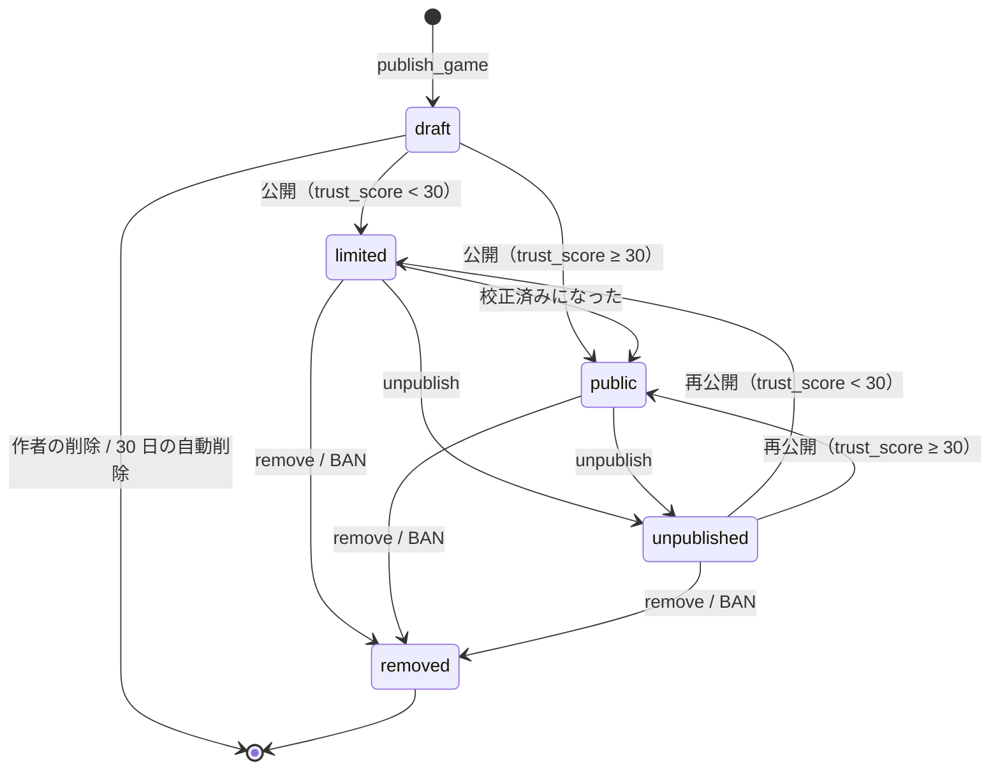

# モデレーション（moderation）

2026-11-07 作成。前提は `product.md` 3（匿名の通報）、7（ゲームの一生）、9（作る側のループ）、`data-model.md` A.2 / A.3 / A.5（列挙型・テーブル・不変条件）、`scoring.md` A.7 / A.8（校正状態）。読む人は API と運営画面の実装者。
節番号は `mo#A.2` のように参照する。A 部が規約、B 部が理由。数値のうち「暫定」と書いたものは A.9 の定数として持ち、実機で変える。

モデレーションは「投稿状態」「通報」「信頼スコア」の 3 つのデータでできている。MVP の時点で遷移はすべて持ち、自動判定の閾値を緩くして人の審査に寄せる。規模が大きくなったら閾値と分類器を変えるだけで、スキーマと遷移は変えない。

---

# A. 規約

## A.1 用語

| 用語 | 意味 |
| --- | --- |
| 基本状態 | `posts.base_status`。`draft` / `limited` / `public` / `unpublished` / `removed` の 5 値（`data-model.md` A.2） |
| 制限 | 可視だった投稿を見えなくすること。個別制限（`posts.indiv_restricted`）とツリー制限（`tree_locks`）の 2 種類 |
| 投稿状態 | 表示用の状態。基本状態と制限から導出する（ビュー `post_status`、`data-model.md` A.4）。制限が効いていれば `restricted` |
| 通報 | 遊ぶ側が投稿に付ける申告（`reports`）。主体は `actor`。重みを持つ |
| 信頼スコア | 作る側の `users.trust_score`（0〜100）。投稿の初期状態、通報の重み、投稿の上限を決める |
| 処分 | 作る側への措置。投稿制限（`users.status = post_restricted`）と BAN（`banned`） |
| 運営 | モデレーター。`moderation_actions.moderator_id` に入る `users` 行。MVP ではオーナーだけ |
| 操作 | 運営の操作。`moderation_kind` 9 種（A.7）。すべて `moderation_actions` に 1 行残る |

## A.2 投稿状態機械

基本状態の遷移。自動の遷移にも「誰が」を書く。

| 遷移 | 誰が | 条件と効果 |
| --- | --- | --- |
| → `draft` | 作者（`publish_game`） | `users.status = active` であること（投稿制限中は error）。1 人 10 件まで（I11） |
| `draft` → `draft` | 作者（`publish_game` に `post_id`） | 内容の置き換え。`draft` の間だけ（I10）。試遊ページの「公開」は `publish: true` と同じ |
| `draft` → `limited` / `public` | 作者（公開） | 公開時点の `trust_score` で分岐。`TRUST_PUBLIC_THRESHOLD`（30、暫定）未満なら `limited`。ここで内容が不変になり、`published_at` と `thumb_key` が入る（I4）。`users` を `FOR SHARE` して `status` を再確認する（I3） |
| `draft` の削除 | 作者（サイト）、日次ジョブ | 行を消す。公開前なので系譜にもランにも痕跡がない（B.6） |
| `limited` → `public` | 自動（校正） | `calibration` が `calibrated` になる遷移（`scoring.md` A.7）と同じトランザクションで昇格する。ただし `indiv_restricted` が立っている、または `upheld` の通報がある投稿は昇格しない（`limited` のまま。復帰は運営） |
| `limited` / `public` → `unpublished` | 作者（`unpublish_game`、サイト） | 可逆の非公開。制限（`indiv_restricted`、`tree_locks`）と通報は触らない。`unpublished` / `draft` に対しては何もせず成功、`removed` は error `invalid_state`、他人の投稿は error `not_found`（存在を漏らさない） |
| `unpublished` → `limited` / `public` | 作者（再公開） | 既に `calibrated` で、`indiv_restricted` も `upheld` の通報もない投稿は `trust_score` によらず `public`（昇格の条件を満たしているため。B.3）。それ以外は再公開時点の `trust_score` で `draft` からの公開と同じ分岐。内容は変わらない（I10）。制限が残っていれば投稿状態は `restricted` のまま |
| `limited` / `public` / `unpublished` → `removed` | 運営（`remove`）、BAN | 終端（I5）。`draft` は `removed` にしない（消す） |

制限は基本状態の遷移ではない。`indiv_restricted` は自動制限（A.4）と運営の `restrict` で立ち、運営の `restore` でだけ下りる。`tree_locks` は運営の `restrict_tree` / `restore_tree` でだけ増減する（A.6）。自動で制限が解けることはない（旧 P9、B.1）。

## A.3 可視性と出題

投稿状態ごとに、誰に何が見えるかと、ランに出るか。

| 投稿状態 | 作者 | 直リンク（ゲームページ・試遊ページ） | 一覧（ゲーム一覧・お題の候補・作者ページ） | 新作枠 | 正規枠 | 系譜表示 |
| --- | --- | --- | --- | --- | --- | --- |
| `draft` | 見える（試遊ページ、デバッグ表示） | 作者のログインがあれば見える。なければ `not_found` | 出ない | 出ない | 出ない | 出ない |
| `limited` | 見える | 見える | 出ない | 入る（`uncalibrated` のとき） | 入らない | 出る |
| `public` | 見える | 見える | 出る | 入る（`uncalibrated` のとき） | 入る（`calibrated` のとき） | 出る |
| `restricted` | 見える（「制限中」と理由） | `not_found` | 出ない | 出ない | 出ない | 「制限中」 |
| `unpublished` | 見える | `not_found` | 出ない | 出ない | 出ない | 「非公開」 |
| `removed` | 見える（「削除済み」と理由） | `not_found` | 出ない | 出ない | 出ない | 「削除済み」 |

- `limited` と `public` の差は一覧と正規枠だけ。新作枠は点数が成績に入らずノーリスクなので（`product.md` 7）、`limited` でも通す。ここで集めた記録で校正し、校正済みになった時点で `public` に昇格する（A.2、B.2）
- 校正状態との組み合わせは A.8。両方の軸で問題がない投稿だけが正規枠に入る
- ランの山札は開始時に確定する（`run.md` A.3）。`next` は発行時に `post_eligibility` を見直し、出せなくなった投稿は手番を消費せず山札の次に進む。ラン開始後に制限・非公開・削除になった投稿は、そのランではもう出ない。発行済みの手番はそのまま遊べ、結果も受理する
- 「見える」直リンクでも、`restricted` / `unpublished` / `removed` のゲーム HTML は配信しない（`security.md`）。`draft` の試遊は作者のセッションでだけ配信する
- `not_found` の文言は「存在しない」と「見られない」で変えない
- お題の 10 本（`theme_posts`）に含まれる投稿が出せなくなったときも同じ規則で飛ばす。その日のデイリーは 9 手番になり、記号列は 10 文字のまま（飛ばした位置は skip の記号、`run.md` A.11）。10 本に埋め直すのは運営の手作業で、埋め直しは翌日から効く（同じ日の順序は変えない。`run.md` A.2）

## A.4 通報

### 受付

`POST /posts/{id}/reports` に `{category, comment?}`。主体は `actor`（`data-model.md` A.1）。

| 項目 | 規則 |
| --- | --- |
| 対象 | 投稿状態が `limited` / `public` / `restricted` の投稿。`draft` / `unpublished` / `removed` は `not_found` |
| 重複 | 1 投稿につき 1 主体 1 回（unique `(post_id, actor_id)`、I14）。2 回目は何もせず成功 |
| 作者自身 | `actors.user_id = posts.user_id` の通報は受け付けない（error `invalid`） |
| 重み | 受付時に計算して `reports.weight` に凍結する。`weight = 信頼係数 × カテゴリ係数`。信頼係数は `actors.user_id` が NULL なら 0（I14、`product.md` 3）、あれば `users.trust_score ÷ 10`（新規 1.0、最大 10.0） |
| 解決 | `resolution` は `open` で始まり、運営の操作で `upheld` / `dismissed` になる（A.7）。自動では変わらない |
| コメント | 任意、200 文字まで。運営だけが読む |

### カテゴリと係数（暫定）

| `category` | 意味 | 係数 |
| --- | --- | --- |
| `sexual` | 性的 | 3 |
| `flashing` | 光過敏（点滅・高コントラストの明滅） | 3 |
| `violence` | 暴力・グロ | 1 |
| `hate` | 差別・中傷 | 1 |
| `copyright` | 著作権・他人の作品 | 1 |
| `loud` | 音量・不快な音 | 1 |
| `spam` | スパム・無内容・宣伝 | 1 |
| `broken` | 動作しない | 0.2 |
| `other` | その他 | 1 |

`sexual` と `flashing` を重くするのは、遊ぶ側に即座の害がある（公共の場で開く、発作）ため。`broken` を軽くするのは、校正の検査（`scoring.md` A.7 の「0 張り付き」）が同じことを点数から判定するので、通報は補助でよいため。

### 自動制限

通報を受け付けるたびに、その投稿の `resolution = open` の通報の重みを合計し、次のどちらかで `indiv_restricted = true` にする。

| 条件 | 閾値（暫定） |
| --- | --- |
| 全カテゴリの重みの合計 | `AUTO_RESTRICT_SUM = 10` 以上 |
| `sexual` / `flashing` だけの重みの合計 | `AUTO_RESTRICT_SEVERE = 5` 以上 |

新規ユーザー（信頼係数 1.0）の通報なら、`sexual` は 2 人（3 + 3 ≥ 5）、`spam` は 10 人で制限がかかる（この水準で始めることは 2026-11-08 にオーナーが承認。#62）。信頼スコア 17 以上のユーザーの `sexual` 通報は 1 件で制限になる。匿名（重み 0）は何人いても自動制限にならず、キューの材料にだけなる。

自動制限は `moderation_actions` に `kind = restrict`、`moderator_id = NULL`、`reason` に重みの内訳を書いた行を残す（`data-model.md` A.3、B.4）。自動制限は通報を解決せず（`open` のまま）、信頼スコアも変えない。通報の解決と信頼スコアの変化は運営の操作（`moderator_id` が非 NULL）でだけ起きる（A.7、B.5）。作者には「制限中」と通報カテゴリの集計だけを見せる（`list_my_games`、「作る」ページ）。`moderation_actions.reason` は運営の内部メモで作者には返さず、通報者が誰かも見せない（件数が少ないときにコメントから通報者が割れるため）。

### キュー

運営画面のキューは `open` の通報を持つ投稿を重みの合計の降順に並べ、`restricted` を先頭に出す。1 行に見せるもの: 静止サムネ、プレビュー動画、通報カテゴリの集計（匿名の件数も）、作者の `handle` と `trust_score`、投稿状態、校正状態、`tree_id` の規模（子孫の数）。運営は A.7 の操作で解決する。

## A.5 信頼スコアと処分

### 信頼スコア

`users.trust_score` は 0〜100 の整数。新規は `TRUST_INITIAL = 10`。増減は次の事象だけで、投稿ごとに各 1 回。範囲外は切り詰める。

| 事象 | 変化（暫定） | いつ |
| --- | --- | --- |
| 投稿が公開から 7 日、`upheld` の通報も制限もない | +5 | 日次ジョブ。`limited` / `public` が対象。`published_at` から数える |
| 投稿が運営に制限された、または通報が `upheld` になった | −20 | 運営の `restrict`、または `upheld` を伴う操作の早い方 |
| 投稿が `removed` になった（運営の `remove`） | −50 | 操作時。BAN では変えない（BAN が終端） |
| 自分の通報が `upheld` になった | +1 | 通報者側。運営の操作時 |
| 自分の通報が `dismissed` になった | −2 | 通報者側。運営の操作時（旧 11.2「却下され続けると重みが下がる」） |

信頼スコアが決めるもの:

| 用途 | 規則 |
| --- | --- |
| 投稿の初期状態 | `TRUST_PUBLIC_THRESHOLD = 30` 以上で `public` から、未満で `limited` から（A.2）。既存の投稿には遡らない |
| 通報の重み | 信頼係数 = `trust_score ÷ 10`（A.4） |
| 投稿の上限 | 30 未満は `PUBLISH_LIMIT_NEW = 5` 件/日、以上は `PUBLISH_LIMIT = 30` 件/日（`publish_game` の新規下書き。置き換えは数えない。`mcp.md`、R-9-4） |

### 処分

| `users.status` | 効果 | 誰が | 解除 |
| --- | --- | --- | --- |
| `active` | 通常 | | |
| `post_restricted` | 新規の `publish_game`（下書きの作成と公開）を error `post_restricted` で拒否する。既存の投稿・試遊・`unpublish_game`・`list_my_games` はそのまま | 運営の `restrict`（`user_id` 指定、A.7）。自動では `trust_score` が 0 になった時点 | 運営の `restore`（`user_id` 指定）。`trust_score` は変えない |
| `banned` | 投稿制限に加え、`removed` でない投稿をすべて同じトランザクションで `removed` にし（I3）、ログインを無効にする。遊ぶ側としての `actor` は残る（匿名と区別がつかないため） | 運営の `ban_user` | 運営の `unban_user`。`status = active` に戻すだけで、`removed` にした投稿は戻らない（終端）。列挙は MVP で置き、操作の実装は Phase 2 |

投稿の挿入は `users` を `FOR SHARE` して `status = active` を再確認する（I3）。BAN と挿入が競合しても、BAN 後に新しい投稿が残らない（旧 P6 の反例）。

## A.6 ツリー一括制限

`restrict_tree(root_post_id)` は `tree_locks` に 1 行入れる。効くのは `root_post_id` から `parent_id` を辿って届く子孫全体（根を含む）で、同じ `tree_id` の兄弟は巻き込まない。可視性はビューで導出するので、ロック中に挿入された子孫も `restricted` になる（旧 P10 の反例）。

`restore_tree(root_post_id)` は `tree_locks` から行を消すだけで、子孫の `indiv_restricted` は触らない。一括制限の前後に個別制限を受けた投稿は、個別の `restore` まで `restricted` のまま（旧 P9 の反例）。入れ子（ロック中の根の子孫を別の根として `restrict_tree`）は許す。外側の `restore_tree` では内側は解けない。

`removed` / `unpublished` / `draft` の投稿は、ツリー制限の対象でも投稿状態は変わらない（導出の優先順位、`data-model.md` A.4）。

## A.7 運営の操作一覧

すべて `moderation_actions` に 1 行書き、状態の変更と同じトランザクションで行う（I6）。`reason` は必須。表の「通報の解決」と「信頼スコア」は運営の操作（`moderator_id` 非 NULL）にだけ適用する。自動制限（`moderator_id = NULL` の `restrict`）は `indiv_restricted` を立てるだけで、通報は `open` のまま、信頼スコアも変えない。運営が自動制限された投稿を `restrict` し直せば（制限は変わらない）、その時点で `upheld` と −20 が起きる。

| `kind` | 対象 | 効果 | 通報の解決 | 信頼スコア |
| --- | --- | --- | --- | --- |
| `restrict` | `post_id` | `indiv_restricted = true`。`draft` / `removed` には使えない | `open` → `upheld` | 作者 −20（未適用なら） |
| `restore` | `post_id` | `indiv_restricted = false`。`limited` / `public` / `unpublished` が対象 | `open` → `dismissed` | 通報者 −2 ずつ。作者は戻さない |
| `remove` | `post_id` | `base_status = removed`。`indiv_restricted` は残す（履歴） | `open` → `upheld` | 作者 −50（と、未適用なら −20） |
| `restrict_tree` | `post_id`（根） | `tree_locks` に挿入 | 子孫の `open` → `upheld` | 根の作者 −20（未適用なら）。子孫の作者は変えない |
| `restore_tree` | `post_id`（根） | `tree_locks` から削除 | 変えない（個別に判断する） | 変えない |
| `restrict` | `user_id`（`post_id` NULL） | `users.status = post_restricted` | 変えない | 変えない |
| `restore` | `user_id`（`post_id` NULL） | `users.status = active` | 変えない | 変えない |
| `ban_user` | `user_id` | `users.status = banned`、全投稿を `removed`（A.5） | その作者の投稿の `open` → `upheld` | 変えない |
| `unban_user`（Phase 2） | `user_id` | `users.status = active`。投稿は `removed` のまま | 変えない | 変えない |
| `calibration_confirm` | `post_id` | `calibration: review → calibrated`（`scoring.md` A.7） | 変えない | 変えない |
| `calibration_invalidate` | `post_id` | `calibration: review → invalid` | 変えない | 変えない |

- `restrict` / `restore` は `post_id` と `user_id` のどちらか一方を持つ（両方 NULL、両方非 NULL は拒否）
- 運営の操作に異議申し立ての導線は MVP では持たない。作者は運営に連絡する（Phase 2 で `list_my_games` に理由と連絡先を返す）
- 運営の操作は運営画面（`apps/web`）からだけ行う。MCP ツールには含めない（`mcp.md`）

## A.8 校正状態との関係

モデレーション（内容が適切か）と校正（ゲームとして成立しているか）は別の軸（`product.md` 5.4）。ランに出るかは両方で決まる。

| 投稿状態 \ 校正状態 | `uncalibrated` | `calibrated` | `review` / `invalid` |
| --- | --- | --- | --- |
| `limited` | 新作枠 | （`public` に昇格するので起きない。起きていれば制限か `upheld` がある投稿で、出さない） | 出さない |
| `public` | 新作枠 | 正規枠 | 出さない |
| `restricted` / `unpublished` / `removed` / `draft` | 出さない | 出さない | 出さない |

- `unpublished` → 再公開で校正状態は引き継ぐ（`calibrated` なら正規枠に戻る）。`post_stats` も捨てない
- `restricted` の間も分布は残る。復帰したら続きから
- `broken` の通報は校正の検査を動かさない。点数の分布だけが校正を決める

## A.9 定数（すべて暫定）

| 名前 | 値 | 使う場所 |
| --- | --- | --- |
| `TRUST_INITIAL` | 10 | A.5 |
| `TRUST_PUBLIC_THRESHOLD` | 30 | A.2, A.5 |
| `TRUST_DELTA_CLEAN_WEEK` | +5 | A.5 |
| `TRUST_DELTA_RESTRICTED` | −20 | A.5, A.7 |
| `TRUST_DELTA_REMOVED` | −50 | A.5, A.7 |
| `TRUST_DELTA_REPORT_UPHELD` | +1 | A.5 |
| `TRUST_DELTA_REPORT_DISMISSED` | −2 | A.5 |
| `REPORT_COEF` | `{sexual: 3, flashing: 3, broken: 0.2, その他: 1}` | A.4 |
| `AUTO_RESTRICT_SUM` | 10 | A.4 |
| `AUTO_RESTRICT_SEVERE` | 5 | A.4 |
| `REPORT_COMMENT_MAX` | 200 | A.4 |
| `PUBLISH_LIMIT_NEW` / `PUBLISH_LIMIT` | 5 / 30 件/日 | A.5 |
| `CLEAN_WEEK_DAYS` | 7 | A.5 |

`packages/domain` に 1 箇所で持ち、API と運営画面が参照する。

## A.10 検査する性質

`verification/Moderation.tla`（旧 13.4 のモデル C。据え置き）と、API の integration テストで確かめる。

| ID | 性質 | 担保 |
| --- | --- | --- |
| M1（旧 P5） | 系譜に閉路がない。`parent_id` は挿入後に変わらない | I1 |
| M2（旧 P6） | BAN されたユーザーの投稿はすべて `removed` | I3、A.5 |
| M3（旧 P7） | `removed` から出る遷移がない | I5 |
| M4（旧 P9） | 個別に制限された投稿は、個別に `restore` されるまで可視にならない（ツリー復帰・再公開・昇格で解けない） | 導出（A.2, A.6） |
| M5（旧 P10） | ツリー制限が有効な間、その子孫に可視の投稿がない（ロック後に挿入された子孫を含む） | 導出（A.6） |
| M6（旧 P11） | 親の削除（`removed`）で子の行が消えない | `ON DELETE RESTRICT`、`removed` は状態 |
| M7 | `unpublished` から戻れるのは `limited` / `public` だけで、内容は変わらない | I5、I10 |
| M8 | 可視になる遷移（復帰・再公開・昇格）が、制限中の投稿を可視にしない | 導出。M4 の言い換え |
| M9 | 自動では制限が解けない。制限の解除はすべて `moderation_actions.kind = restore / restore_tree` を伴う | I6 |
| M10 | 匿名の通報は何件あっても自動制限を起こさない | I14、A.4 |

---

# B. 解説（規則の理由と却下した案）

## B.1 可視性を基本状態と制限から導出する理由

投稿の状態を 1 列（`status`）で持ち、制限で `restricted` に書き換えて復帰で元の値に戻す設計は、旧仕様の形式検証（モデル C）で 2 つの性質に違反した。ツリー制限中に新しく挿入された投稿や、制限中に別の経路で状態が変わった投稿（当時は Showcase 録画で `pending → public`、今なら `limited → public` の昇格と `unpublished` からの再公開）が「ツリーが制限中」という事実をどこにも持たないため可視になる（P10 違反）。ツリー復帰で「前の値」に戻すと、その間に個別制限を受けた投稿まで可視になる（P9 違反）。

基本状態（作者と校正が動かす）と制限（運営と通報が動かす）を別の列に持ち、表示用の状態をビューで導出すれば、どちらの経路で基本状態が動いても制限は残る。復帰は「制限の理由を 1 つ外す」だけで、他の理由が残っていれば見えないまま。代償はビューが 1 つ増えることだけ。

## B.2 `limited` を新作枠に入れ、校正済みで昇格させる理由

旧仕様の `limited` は「フィードに出ず直リンクのみ」で、`public` への昇格の規則がなかった。新しい `product.md` では新作枠そのものが「ノーリスクの露出」で、投稿が 20 プレイ集めるまでは成績に入らない。これは露出制限として `limited` に求めるものと同じなので、`limited` でも新作枠には通し、一覧と正規枠だけを閉じる。

`limited` をランから完全に外す案は、新規ユーザーの投稿が直リンク以外で遊ばれず、校正が始まらない。信頼スコアが 30 に達するまで（7 日 ×4 件）直リンクだけで待たせるのは、作る側の最大のフック（「ランに入りました」の通知）を新規ユーザーから奪う。

昇格の条件を「校正済み」にするのは、20 プレイ分の露出を経て通報が閾値に達していないことが、人の目視より早く安く得られる審査だから。制限中・`upheld` のある投稿は昇格しない。信頼スコアが後から 30 に達しても既存の `limited` を遡って昇格させないのは、昇格の経路を 1 本にして M8 を単純に保つため。

## B.3 `unpublish_game` を可逆にする理由

`product.md` 9 の 6 と #42 の 2。作者が旧版を止めたくなる場面は「直した新版を出したから」が多く、後で「やはり旧版も残す」に戻れる方がよい。`removed` にすると終端で戻れず、運営の操作と区別がつかない。`unpublished` を別の基本状態にしたのは、`draft` と違って内容が不変でセッションが参照しているため（`data-model.md` B.6）。

再公開の初期状態は、校正済みで制限も `upheld` もない投稿なら `trust_score` によらず `public` に戻す。昇格の条件（A.2）を既に満たしている投稿を `limited` に戻すと、昇格の契機（`calibrated` になる遷移）がもう来ないので `limited` に留まってしまう。それ以外は `draft` からの公開と同じ分岐にして規則を 1 つにする。

## B.4 自動制限の監査行に `moderator_id = NULL` を使う理由

自動制限も `moderation_actions` に残さないと、運営画面で「誰がいつ何を」が通報の集計から再構成する形になり、復帰（I6）の対になる行がない。システム用の `users` 行を作る案は、`handle` の予約と `trust_score` の意味がない行を持つことになる。`moderator_id` を NULL 可にして「NULL = 自動」と読む方が、列の意味がそのまま残る。

## B.5 通報の解決を運営の操作に結びつける理由

通報の `resolution` を運営が 1 件ずつ付ける案は、同じ投稿に 10 件の通報があると 10 回の操作になる。運営が判断するのは投稿であって通報ではないので、投稿への操作（`restrict` / `remove` は `upheld`、`restore` は `dismissed`）で `open` の通報を一括で解決する。通報者の信頼スコアへの反映もこの時点で 1 回だけ起きる。`restore_tree` で解決しないのは、子孫の通報は根の判断と独立だから。自動制限で解決しないのは、閾値は「人が見るまで隠す」ための装置で判断ではないから。自動で `upheld` にすると、通報が集まっただけで作者の信頼スコアが下がり、通報者の信頼スコアが上がる。それは通報の組織化に報酬を与える。

## B.6 `draft` を `removed` にせず消す理由

`draft` は公開前で、一覧にもランにも系譜にも出ていない。消しても誰の表示も壊れない。残すと I11 の上限（10 件）の数え方と「削除した下書きが 30 日後にまた消える」の二重管理が要る。試遊セッション（`sessions.run_id` が NULL でその `post_id` を指す行）は `sessions.post_id` の `ON DELETE CASCADE` で一緒に消える。公開後の投稿は行を消さない（`removed` は状態）ので、カスケードが効くのは下書きだけ。R2 の `replays/{session_id}` は孤児になるが、試遊のログは検証に使わないので日次ジョブで掃除する（`data-model.md` A.3）。

## B.7 通報の重みを受付時に凍結する理由

通報者の信頼スコアは後で動く。受付時に `reports.weight` に書いておけば、自動制限の判定が過去の通報を読み直すときに同じ値で再計算でき、監査行の `reason` に書いた内訳とも一致する。通報者の信頼スコアが下がったことを過去の通報に遡って効かせる案は、制限の判定が時間とともに勝手に変わるので採らない。

## B.8 信頼スコアを 0〜100 の整数にし、重みを ÷ 10 で読む理由

旧 11.2 の「通報者の信頼スコア × カテゴリ係数」は尺度が書かれておらず、新規の 10 × 係数 1 = 10 で閾値 10 に単独で届く読み方も、届かない読み方もできた。÷ 10 にして新規 1.0 と定めると、閾値 10 は「新規 10 人」、`sexual` の 5 は「新規 2 人、信頼 17 以上なら 1 人」と数えられる。値そのものは暫定で、運営がキューを見ながら動かす。

---

## 未解決

- 自動制限の閾値（A.9）を運営のキューの実績で見直す時期。制限が月に数件以下なら下げ、誤制限が続くなら上げる
- 異議申し立ての導線（Phase 2。MVP は作者が運営に連絡する、A.7）
- `unban_user` の操作の実装（Phase 2。列挙は置いてある）
