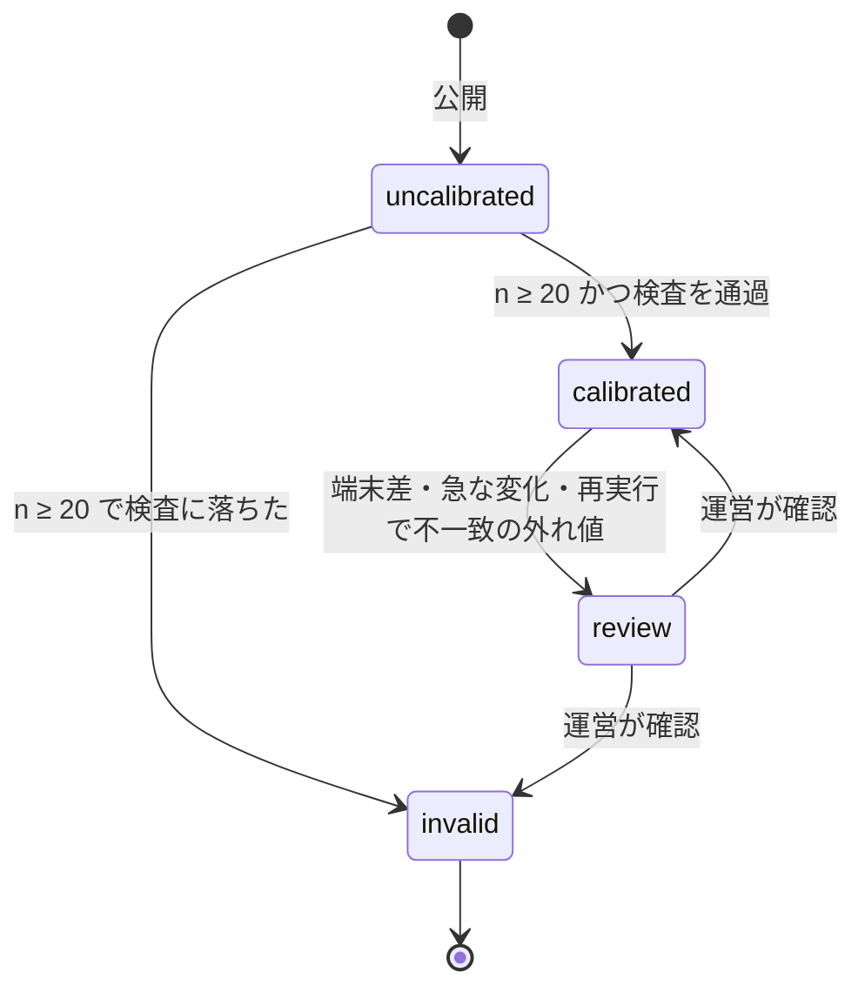

# 点数・校正・偏差値（scoring）

2026-11-07 作成。前提は `docs/product.md` 5（点数と偏差値）、7（ゲームの一生）、8（共有物）と `docs/protocol.md`、`docs/run.md`。読む人は API と検証・描画ワーカーの実装者。
節番号は `sc#A.5` のように参照する。A 部が規約、B 部が理由。数値のうち「暫定」は定数として持つ。

---

# A. 規約

## A.1 用語

| 用語 | 意味 |
| --- | --- |
| 結果 | 1 セッションの `score`, `frames`, `via`（`protocol.md` A.7）と入力ログ |
| verdict | 結果の検証状態。`provisional` / `accepted` / `rejected` / `flagged` |
| 分布 | 1 つのゲームについて、偏差値の計算に使う結果の集合（A.4） |
| 偏差値 | 分布の中の順位から出す値（A.5）。20〜80 |
| 校正状態 | ゲームが偏差値を出せる状態かどうか。`uncalibrated` / `calibrated` / `invalid` / `review`（A.7） |
| `miss_below` | エンドレスの手番で、何点未満ならミスかを表す生の点数（A.6） |
| 凍結 | ランの終わりに成績表の値を確定し、以後の分布の変化で変えないこと（A.9） |

## A.2 結果の受理（`PUT /sessions/{id}/result`）

受理の条件。1 つでも外れたら拒否し、Host には「このセッションは無効」を返す（`run.md` A.6 の skip）。

| 条件 | 外れたとき |
| --- | --- |
| セッションが `open`（発行済みで未提出） | 409。2 回目以降の提出は常に 409（冪等） |
| 発行から 30 分（暫定）以内 | 拒否。期限切れ |
| `score` が整数で 0〜2³¹−1 | 拒否 |
| `frames` が 1〜`time_limit` | 拒否 |
| 入力ログの `frame` が単調非減少で、最大値が `frames` 以下 | 拒否し `flagged` |
| `frames ÷ (60 × speed)` が、発行からの経過秒 × 1.05 ＋ 3 以下 | 拒否し `flagged`（実時間より多くのフレームを申告） |
| `via` が `guest` / `timeout` / `error` のどれか。`timeout` / `error` なら `score = 0` | 拒否 |

受理したら `submitted` にし、verdict を `provisional` にして、応答に表示用の値を返す。

```json
{ "deviation": 57.3, "miss": false, "calibration": "calibrated", "ratio": null }
```

`deviation` は校正済みのときだけ。校正中は `ratio = min(1, score / target)`。`miss` は発行時に凍結した `miss_below` で判定した値で、Host の判定（`run.md` A.7）と一致する。

試遊ページからの結果は `author: true` を付けて送られ、保存はするが分布に入れない（A.4）。

## A.3 検証の 3 段階

| 段階 | いつ | 対象 | 判定 |
| --- | --- | --- | --- |
| 1 | 受理時（同期） | すべて | A.2 の条件。通れば `provisional` |
| 2 | 受理後、数秒〜数分（非同期） | (a) そのゲームの分布の上位 10 位以内に入った結果 (b) 外れ値（A.7）(c) 校正前のゲームの最初の 20 件のうち無作為に 5 件（暫定）(d) `flagged` | 検証ハーネス（A.10）で同じ `seed`・`speed`・入力ログから再実行し、`score` が一致すれば `accepted`、違えば `rejected` |
| 3 | 日次 | 総合の記録の上位 100 人の直近の結果。同一ユーザーの異常（全ゲームで上位 1% など） | 再実行で確認。異常は `flagged` にして運営の確認待ち |

- `rejected` は分布から外し、本人には「検証できませんでした」を返す。同一ユーザーで月 3 回（暫定）を超えたら、そのユーザーの結果はすべて `provisional` 止まり（総合の記録に載らない）
- `gf:deterministic="false"` のゲームは再実行で一致しないので、第 2 段階を行わず `flagged` のまま。投稿内の順位には載るが総合の記録には載らない
- 再実行は `onDraw` なし（`protocol.md` A.11）。1 本あたり `time_limit ÷ (60 × speed)` 秒より短い

## A.4 分布

ゲームごとの分布に入る結果の条件。

| 条件 | 理由の節 |
| --- | --- |
| verdict が `provisional` か `accepted` | B.3 |
| `speed = 1.0`（エンドレスの 1 周目とデイリー） | B.4 |
| `author = false` | B.5 |
| `frames ≥ 0.9 × time_limit`（遅い端末で短縮されたセッションを除く。暫定） | B.6 |
| `via` は問わない。`timeout` / `error` は `score = 0` として入る | B.7 |
| 1 ユーザー 1 ゲームにつき直近 5 件まで（暫定） | B.8 |

分布は結果ごとに更新し、ゲームページの表示と `miss_below` の計算に使う。実装は点数の昇順の配列（または分位点の表）で、更新は受理のトランザクション内で行う。

## A.5 偏差値

結果 `s` の偏差値は、そのゲームの分布（`s` 自身を除く `n` 件）に対して次で求める。

1. `L` = `s` より小さい点数の件数、`E` = `s` と同じ点数の件数
2. `p = (L + 0.5 × E + 0.5) ÷ (n + 1)`
3. `z = Φ⁻¹(p)`。`Φ⁻¹` は標準正規分布の逆関数で、Acklam の有理近似（相対誤差 1.2 × 10⁻⁹）を使う
4. `偏差値 = 50 + 10 × z` を小数 1 桁に丸め、20〜80 に収める

性質:

- 点数が高いほど偏差値は高い（同点は同じ）
- `n` が小さいほど到達できる上限が低い。`n = 20` で最大 69.8、`n = 100` で 75.8、`n = 1000` で 80（上限）。記録が貯まるほど高い偏差値が狙えることを隠さない（`product.md` 5.2）
- 校正前（`n < 20`）は偏差値を出さず `ratio` を出す

## A.6 `miss_below`

エンドレスの手番の発行時（`run.md` A.3）に、校正済みのゲームについて次で求め、セッションに凍結する。

- 閾値の偏差値 40 は `p = Φ(−1) = 0.158655`
- `miss_below` は、発行時点の分布（`n` 件、新しい結果はまだ含まない）に対して A.5 の手順で偏差値を計算したとき、偏差値が 40 以上になる最小の点数 `s`（`s ≥ 0` の整数）。偏差値は点数について単調非減少なので、この `s` は一意に決まる
- 候補は分布に現れる点数と「現れる点数 + 1」だけなので、昇順配列の二分探索で求まる。順位の `k` 番目のような閉じた式では同点（`0.5E`）の扱いがずれるので使わない
- ミスは `score < miss_below`。`miss_below` が 0 のときはミスが起きない（分布の 16% 以上が 0 のゲーム）

`A.5` の定義と整合する: 新しい結果 `score` を同じ分布に対して評価したとき、`score < miss_below` のときに限り偏差値が 40 未満になる（`verification/scoring_check.py` の S4。境界の `n` を含む）。

校正前・新作枠・デイリーは `null`。

## A.7 校正状態と分布の検査

ゲームの校正状態は `posts` に持ち、モデレーションの投稿状態とは別の軸（`product.md` 5.4）。



検査は `n ≥ 20` から結果ごとに行う。閾値はすべて暫定。

| 検査 | 条件 | 結果 |
| --- | --- | --- |
| 分散ゼロ | 全件同じ点 | `invalid`。作者に「点が動いていません」 |
| 0 張り付き | 0 の割合 ≥ 80% | `invalid`。作者に「開始直後に操作できないか、難しすぎます」 |
| 二峰 | 0 と最大値で全体の ≥ 90% | 成立。表示を「クリア率」に切り替える印を立てる |
| 耐久型 | `score` と `frames` の相関 ≥ 0.9 | 成立。印を立てるだけ（`product.md` 5.4） |
| target のずれ | P90 > 3 × target、または P50 < target ÷ 10 | 作者に通知。状態は変えない |
| 外れ値 | `score > max(20 × 中央値, P99 + 10 × IQR)` | その結果を第 2 段階へ。再実行で一致すれば作者に「ゲームの穴」を通知、不一致は `rejected` |
| 端末差 | iOS と Android の分布の最大差（KS 距離）≥ 0.3、各 50 件以上 | `review` |
| 急な変化 | 直近 50 件と全体の KS 距離 ≥ 0.3 | `review` と、直近 50 件から 5 件を第 2 段階へ |

`invalid` は終端。直すなら新しい投稿として出す（`product.md` 7）。

## A.8 校正状態とランへの出題

| 校正状態 | 投稿状態が `public` のとき | 投稿状態が `limited` のとき |
| --- | --- | --- |
| `uncalibrated` | 新作枠にだけ入る | 新作枠にだけ入る |
| `calibrated` | 正規枠に入る | （`calibrated` になる遷移で `public` に昇格する。昇格できない投稿は入らない） |
| `review` / `invalid` | 入らない | 入らない |

投稿状態が `public` / `limited` 以外なら校正状態によらず入らない（`moderation.md` A.3 / A.8）。

エンドレスで正規枠に入れる校正済みが足りない間は、`uncalibrated` が正規枠の空きも埋める。扱いは新作枠と同じ（`run.md` A.2、B.10）。

## A.9 成績表の凍結値

`POST /runs/{id}/finish` でサーバが計算し、`runs` に保存する。以後、分布が変わっても変えない。

| 項目 | 定義 |
| --- | --- |
| 手番ごとの偏差値 | `result` 受理時に計算した値（A.5）。校正中は `ratio`、skip と `abandoned` は `null` |
| 到達手番数（エンドレス） | 3 回目のミスが起きた手番までの手番数（skip を含む）。ミスが 3 回に満たなければ遊んだ手番数。3 回目のミス以降に発行された手番の結果は捨てる。結果のない手番（`abandoned`）は、最後に結果のある手番より後なら数えず、それより前なら `miss_below` が非 NULL のときミス、NULL のとき skip として数える（`run.md` A.7、B.2） |
| 平均偏差値 | 偏差値が `null` でない手番の算術平均。小数 1 桁。該当する手番がなければ `null` |
| 記号列（デイリー） | 手番ごとに `◎`（60 以上）`○`（50 以上）`△`（40 以上）`×`（40 未満）`—`（skip・校正中）。暫定 |
| 保存 | エンドレスは毎回。デイリーは同じ山札で初回のみ（`run.md` A.2） |

判定（A〜E）は持たない。将来足すなら、平均偏差値の分布から閾値を決める（B.10）。

## A.10 サーバの描画と検証ハーネス

headless Chromium の中で `protocol.md` の Host を動かす。3 つの用途で同じハーネスを使う。

| 用途 | モード | いつ | 出力 |
| --- | --- | --- | --- |
| 公開前の実行チェック | `play`、入力なし、`speed` 1.0 と 1.5 | 公開ボタン（`product.md` 9） | 監視タイマー内に `end` が届かなければ公開を拒否（「固まります」）。届けば次へ |
| 静止サムネ | `play`、入力なし | 公開時 | フレーム 90 の描画を WebP で保存 |
| プレビュー動画 | `replay`（`onDraw` あり） | 作者以外の最初の結果の受理後 | フレーム 60〜180（2 秒、暫定）を MP4/WebM で保存 |
| 結果の検証 | `replay`（`onDraw` なし） | A.3 の第 2・3 段階 | `end.score` |
| 共有物 | `replay`（`onDraw` あり） | 成績表の共有時 | 成績表の画像、2 秒のクリップ |

ハーネスは Guest を本番と同じ配信経路（`security.md`）で読み込む。ハーネス専用の緩和は持たない。

## A.11 検査する性質

`verification/scoring_check.py` で数値的に確かめる。TLA+ ではない。

| ID | 性質 |
| --- | --- |
| S1 | 同じ分布に対して、点数が高いほど偏差値は高いか等しい |
| S2 | 偏差値は常に 20〜80 |
| S3 | `n = 20` で到達できる最大は 69.8 |
| S4 | 新しい結果を発行時点の分布に対して評価したとき、`score < miss_below` ⇔ 偏差値 < 40。分布にある点数・ない点数・境界の `n`（20〜60）のすべてで |
| S5 | 0 張り付き・二峰・長い尾・全件同点の分布で、計算が有限の値を返し例外を出さない |
| S6 | 凍結後に分布へ結果を足しても、凍結した値は変わらない |

---

# B. 解説（規則の理由と却下した案）

## B.1 順位から偏差値を出す理由

`product.md` 5.2。ゲームの点数分布は正規分布から遠い（0 張り付き・長い尾・二峰）。平均と標準偏差から出すと、外れ値 1 人で 150 が出る。順位を `Φ⁻¹` に通せば分布の形によらず「上位 2.3% なら 70」が成り立つ。

## B.2 `p` に `+0.5` と `n + 1` を入れる理由

`n` 件の中で最上位でも `p = 1` にならないようにする（`Φ⁻¹(1)` は無限大）。`(L + 0.5E + 0.5) ÷ (n + 1)` は順位の中央化で、`n` が小さいほど上限が下がる性質がそのまま「記録が貯まるほど高い偏差値が狙える」になる。20〜80 のクランプは、`n` が数万になったときの極端な値を表示から外すため。

## B.3 分布に `provisional` を入れる理由

`accepted` だけにすると、第 2 段階は上位と外れ値にしか行わないので分布がほとんど空になる。不正な結果が混ざる危険は、外れ値検査（A.7）と第 2 段階の `rejected` で分布から外すことで抑える。

## B.4 分布を `speed = 1.0` だけにする理由

`product.md` 5.2。速度別に分布を持つと速い帯の記録が薄くて校正できない。等速だけなら、デイリー（常に 1.0）とエンドレスの 1 周目から十分に貯まる。速い周回の結果は等速の分布に対して偏差値を出すので、速いほど偏差値が下がり、それがそのまま難度の上昇になる（`run.md` B.2 の前提）。

## B.5 作者の結果を分布に入れない理由

`product.md` 9。作者は自分のゲームを一番やり込んでいるので分布を歪める。試遊ページの結果は `author: true` で区別する。公開後に作者がランで自分のゲームに当たった場合も同じ扱い（`user_id` が作者と一致）。

## B.6 短縮されたセッションを分布から外す理由

`protocol.md` A.4 の壁時計 `end` で `frames < time_limit` になったセッションは、端末が遅かっただけで点数が低い。本人の偏差値は出す（本人の端末の問題なので本人が引き受ける）が、分布に入れると遅い端末の多さで難度が変わる。90% は暫定。

## B.7 監視タイマー満了と `error` を 0 として分布に入れる理由

`protocol.md` B.3。固まるゲームは 0 に張り付いて `invalid` になってほしい。遊ぶ側のランでは skip なので、遊ぶ側が損をすることはない。

## B.8 1 ユーザー 5 件までにする理由

同じ人が同じゲームを 100 回遊ぶと、その人の腕が分布を決めてしまう。ユーザーごとの最高点だけにする案は、分布が「各人のベスト」になって中央値が上がりすぎ、普通に遊んだ人の偏差値が下がる。直近 5 件なら練習の効果は残しつつ 1 人の重みを抑えられる。暫定。

## B.9 成績表を凍結する理由

`product.md` 5.3。分布は動く（後から上手い人が来る）ので、凍結しないと「先週の 62 が今週の 58」になる。過去のランは確定時の値で止め、動くのはゲームページの「今の偏差値」だけ。

## B.10 判定（A〜E）を持たない理由

偏差値自体が受験の語彙で、判定は平均偏差値を 5 段に丸めただけ。閾値を今決める根拠がなく、後から変えると「先週の A が今週の B」になる。さらに A.5 の性質で、記録が少ないゲームほど到達できる偏差値が低いので、固定の閾値はゲームの遊ばれ方で不公平になる。足すなら平均偏差値の分布から「上位 10% を A」のようにデータで決める。表示層の派生値なので後から足せる。

## B.11 検証を上位・外れ値・無作為に絞る理由

全結果を再実行すると結果 1 件あたり数秒の headless 実行になり、プレイ数に比例してコストが伸びる。順位に影響するのは上位と外れ値だけで、校正前の無作為 5 件は決定論性の破れ（端末差）を早く見つけるため。

---

## 未解決

- 分布の保持方法。昇順配列を DB に持つか、分位点の表（101 点）を Redis に持つか。`n` が数万になったときの更新コストで決める
- 1 ユーザー 5 件の窓と、校正の 20 件の数え方（同一ユーザーの 5 件を 5 と数えるか 1 と数えるか）
- 端末差の検査に使う端末種別の取り方（User-Agent か、Host が `result` に添えるか）
- プレビュー動画の切り出し位置。フレーム 60〜180 固定か、入力が最も多い 2 秒か
